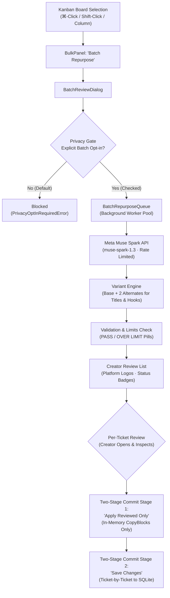

# Reelay Batch Repurpose Guide (v2 Shippable)

**Author:** Andrew Baxter  
**Platform:** Reelay (macOS / Windows PySide6 Desktop Application)  
**Release:** Post-Hackathon Product Work (Branch `batch-v2`)  
**AI Engine:** Meta Muse Spark (`muse-spark-1.3` via Meta Model API at `https://api.meta.ai/v1`, Standard Non-Contributor Tier)  

---

## 1. The Real-World Problem: Archives Demand Batch Processing

For video creators, content repurposing is high-leverage but operationally punishing. When managing a back catalog or an active archive of long-form and short-form videos, single-ticket repurposing creates intense friction:

* Opening each video card individually.
* Launching a single-ticket generation dialog.
* Waiting synchronously for API generation.
* Reading and proofreading copy in isolation.
* Applying to the card and saving to SQLite one at a time.
* Repeating this cycle dozens or hundreds of times.

**Reelay Batch Repurpose** transforms Reelay from a single-ticket tool into a true batch repurposing powerhouse. Creators can select multiple videos directly from their Kanban board, queue background generation across six platforms simultaneously, inspect creative variants for titles and opening hooks, and commit copy with ironclad two-stage approval.

> [!IMPORTANT]
> **Core Principle: AI Proposes, Creator Decides.**  
> Reelay never auto-publishes, never auto-schedules, and never auto-saves generated copy to your database. Every single proposal remains strictly in memory until you review and explicitly commit it.

---

## 2. Architecture & Lifecycle Overview

The batch repurposing pipeline isolates network I/O, background thread management, variant generation, and UI state without ever locking the desktop interface:



---

## 3. How Batch Repurposing Works: Step-by-Step

### 3.1 Selecting Multiple Tickets on the Board

Reelay's Kanban board (`reelay/gui/board_page.py`) supports intuitive multi-ticket selection:

1. **Arbitrary Selection:** Hold `⌘` (Cmd on macOS) or `Ctrl` (on Windows) and click video cards across any columns.
2. **Contiguous Selection:** Click a card, hold `Shift`, and click another card in the column to select the entire range.
3. **Column Bulk Selection:** Select an entire stage (such as `Backlog`, `Ready`, or `Scripted`) to queue all videos in that column.

When two or more cards are selected, the **BulkPanel** docks at the bottom of the board, displaying the count of selected cards and an action button:
```
[ 10 Videos Selected ]  ──►  [ Batch Repurpose with Muse Spark ]
```

---

### 3.2 The Batch Repurpose Dialog (`BatchReviewDialog`)

Clicking **Batch Repurpose with Muse Spark** opens the dedicated batch workspace (`reelay/gui/batch_dialog.py`). 

* **Creator-Focused Header:** Displays `"Repurpose these videos (N videos selected)"` with the subtext:  
  *`"One batch, six platforms each, you approve before saving."`*
* **Platform Visibility:** Platform logo chips for all 6 target networks remain clearly visible across the entire dialog:
  * YouTube (`youtube`)
  * TikTok (`tiktok`)
  * Instagram Reels (`instagram`)
  * Bluesky (`bluesky`)
  * Threads (`threads`)
  * Facebook (`facebook`)

---

### 3.3 The Privacy Gate & Cloud AI Opt-In

Reelay is local-first by design. Media files, metadata, and post revisions live in your local SQLite database (`videos.db`). 

To protect creator privacy, **Cloud AI generation is OFF by default** and strictly gated:

* **Explicit Batch Opt-In:** Every batch session requires checking:  
  `[ ] Allow Muse Spark to draft copy for this batch`
* **Zero Persistence of Consent:** Consent defaults to unchecked every time the batch dialog opens. Even if a single-ticket repurpose was previously run, batch generation cannot start without fresh creator consent for this specific batch.
* **Failure to Opt In:** Attempting to start generation while unticked displays a prominent warning and prevents any network requests (`PrivacyOptInRequiredError`).
* **Transparency Disclosure:** Clicking the **"ⓘ How it works"** link opens the full technical privacy disclosure:
  * **Provider:** Meta Model API (`https://api.meta.ai/v1`)
  * **Model:** Meta Muse Spark (`muse-spark-1.3`)
  * **Tier:** Standard non-contributor tier
  * **Zero Model Training:** In the Standard non-contributor tier, Meta does not use request transcripts, titles, or notes to train foundation models.
  * **Prompt Isolation:** Spoken transcripts are wrapped in `<input_transcript>` tags with closing-tag escaping (`</input_` &rarr; `< /input_`) so transcripts are framed strictly as data, not system instructions.

---

### 3.4 Background Generation & Concurrency

Once opt-in is confirmed and you click **"Start Batch"**, processing runs completely in the background via `BatchRepurposeQueue` (`reelay/batch_repurpose.py`):

* **Non-Blocking UI:** The PySide6 desktop interface remains fully interactive and smooth. You can scroll, switch views, or inspect already completed proposals while remaining tickets generate.
* **Rate-Limited Concurrency:** The queue caps worker concurrency to respect Meta Model API thresholds, preventing burst 429 rate limit errors.
* **Real-Time Progress Tracking:** A progress bar and status indicator display live batch statistics:  
  *`"Generating 4 of 10… · 3 ready · 0 failed"`*
* **Granular Cancellation:**
  * **Cancel Entire Batch:** The **"Cancel Batch"** button aborts all queued and running jobs immediately. Any proposals already completed remain intact and ready for review.
  * **Cancel Single Ticket:** Each ticket row features a cancel icon to drop an individual video from the queue without affecting others.

---

### 3.5 The Variant Engine: Creative Choice Without Invention

Titles and first-second hooks determine video reach. A single rigid AI proposal rarely captures the nuances of a creator's archive. Reelay's **Variant Engine** (`reelay/variants.py`) generates targeted alternates:

* **Focused Scope:** Up to 3 variants (1 base proposal + up to 2 alternate variants) are generated for high-leverage fields:
  1. **YouTube Title:** High-CTR, search-optimized, and question/hook variants.
  2. **Short-Form Hook:** Opening first-second spoken hooks for TikTok and Instagram Reels.
* **Zero Mechanical Truncation:** Variants are never chopped off with an ellipsis or sliced mid-word. Every variant is generated strictly to fit within `reelay.platform_specs.FIELD_LIMITS`.
* **The No-Invention Rule:** Variants are grounded strictly in the source transcript, title, and creator notes. The model is explicitly instructed never to hallucinate sponsor mentions, fake quotes, external claims, or unverifiable facts.
* **Editorial Standards:**
  * **No Em Dashes:** Following Reelay's copy guidelines, em dashes (`—` or `--`) are strictly prohibited in generated copy.
  * **Threads Clean Body:** Hashtags are never left in the body text of Threads posts; they are automatically extracted and merged into the shared `hashtags` field.
* **Interactive Variant Switcher:** When inspecting a ticket, a clean pill selector (`[Primary]`, `[Hook Angle]`, `[Direct Story]`) lets you toggle between variants. The selected variant immediately updates the preview and character count.

---

### 3.6 The Review Flow: Visual Compliance at a Glance

The batch queue displays each video ticket with instant visual auditing:

| Visual Element | Meaning / Behavior |
| :--- | :--- |
| **Thumbnail & Title** | Original video thumbnail preview and source file title. |
| **Platform Logos** | Colored logo icons for all 6 active networks (YouTube, TikTok, Instagram, Bluesky, Threads, Facebook). |
| **Status Pill** | `Queued` (gray) &rarr; `Running` (blue) &rarr; `Ready` (emerald) &rarr; `Failed` (ruby) &rarr; `Applied` (cyan) &rarr; `Saved` (green). |
| **Compliance Pill** | **`PASS`** (green pill) when all 9 fields satisfy character and byte limits. <br>**`OVER LIMIT`** (red pill) if any field exceeds destination limits. |
| **Audit Pill** | **`Unreviewed`** (neutral outline) vs **`Reviewed`** (filled purple pill). Updates to `Reviewed` when the creator clicks "Review" and inspects the copy. |
| **Persistence Pill** | **`In Memory Only`** (default after generation/apply) vs **`Saved`** (persisted to SQLite). |

Clicking **"Review"** on any ready ticket opens the full proposal inspector, displaying all 9 fields with live character counters, byte limit progress bars, and full text editing capabilities.

---

### 3.7 Two-Stage Commit Safety: How Changes Are Applied & Saved

To eliminate accidental overwrites or unwanted bulk changes, Reelay enforces an unconditional **Two-Stage Commit**:

```
[ Batch Proposals in Memory ]
              │
              ▼
    Stage 1: "Apply Reviewed Only"
    (Populates in-memory CopyBlocks ONLY for tickets with reviewed == True)
              │
              ▼
    Stage 2: "Save Changes"
    (Creator explicitly clicks Save Changes per ticket to persist to SQLite)
```

#### Stage 1: "Apply Reviewed Only"
* The primary batch action button is labeled **"Apply Reviewed Only (X of N)"**, where `X` is the exact number of tickets you have opened and inspected (`reviewed == True`).
* If you batch 10 tickets and only review 3, clicking the button applies **only those 3 tickets**.
* **Unreviewed tickets are NEVER applied.** Even if generation succeeded, unreviewed proposals remain in memory and will not touch ticket fields.
* **In-Memory Only:** Applying copy populates the `CopyBlock` widgets in memory. **Zero database writes occur during Stage 1.**

#### Stage 2: "Save Changes" (Ticket-by-Ticket Commit)
* The creator reviews the ticket in Reelay's inspector panel and clicks **"Save Changes"**.
* This commits the validated copy to the local SQLite `posts` and `videos` tables, recording an audit revision in `revisions`.
* **Zero Auto-Publishing:** Reelay never publishes to YouTube, TikTok, Bluesky, Threads, or Facebook autonomously. You retain 100% control over when and how media is uploaded or scheduled.

---

### 3.8 Retry & Failure Recovery

In real-world networks, batch operations must handle rate limits, transient drops, or edge-case videos gracefully:

* **Failure Isolation:** If 1 video in a batch of 10 fails (e.g. Meta API rate limit 429, socket timeout, or empty transcript), **only that specific ticket is marked `Failed`**.
* **Non-Stop Batch:** The remaining 9 tickets continue generating, validating, and moving to `Ready`. A single failure never halts or crashes the batch.
* **Sanitized Error Reporting:** Error messages display safe, readable diagnostics (e.g., `"Meta API Rate Limit (429) - Retry available"` or `"Validation Error: Title exceeds limit"`). Authorization headers and API keys are strictly redacted and never logged or displayed.
* **Individual Retry:** Each failed ticket row has an active **"Retry"** button. Clicking "Retry" re-queues only that video without re-running or touching completed proposals.

---

## 4. Creator Pre-Flight & Quick Reference

### Setup Checklist

1. **Configure Meta Model API Key (One-time):**  
   Save your API key securely into your operating system Keychain using Reelay's secure setup prompt:
   ```bash
   python -m reelay.repurpose_engine --setup
   ```
2. **Verify Configuration:**  
   Confirm the key is detected without exposing it:
   ```bash
   python -m reelay.repurpose_engine --check
   ```
3. **Set Up Brand Voice (Optional but Recommended):**  
   Open **Settings &rarr; Brand Voice** in Reelay. Define your tone (e.g., *"Direct, technical builder tone; no corporate jargon"*), avoid-phrases, and default hashtags. Muse Spark will tailor all batch proposals to match this profile.
4. **Launch Reelay:**
   ```bash
   ./.venv/bin/python -m reelay
   ```

### Recommended Batch Sizes

* **Optimal: 5 to 15 Videos.** This range offers the best balance between fast background generation and thoughtful creator review.
* **Large Batches (20+ Videos):** Permitted, but we recommend reviewing and applying in smaller subsets using "Apply Reviewed Only".

---

## 5. Summary of Shippable v2 Guarantees

| Guarantee | Implementation |
| :--- | :--- |
| **Local-First** | Default operation is 100% offline. SQLite database (`videos.db`) on your disk. |
| **Privacy Gate** | Explicit per-batch opt-in checkbox. Blocked if unticked (`PrivacyOptInRequiredError`). |
| **AI Tier & Model** | Meta Muse Spark (`muse-spark-1.3`) on `https://api.meta.ai/v1` (Standard Non-Contributor Tier; zero model training). |
| **Two-Stage Commit** | In-memory `Apply Reviewed Only` followed by manual `Save Changes`. |
| **Unreviewed Exclusion** | Tickets with `reviewed == False` are strictly excluded from batch application. |
| **Truncation Policy** | Zero mechanical truncation. Platform limits enforced via `reelay.platform_specs`. |
| **Style Policies** | No em dashes (`EM_DASH_RULE`). Threads body hashtag migration to shared field. |
| **Failure Isolation** | 1 failure does not abort the batch. Individual retry supported per ticket. |
